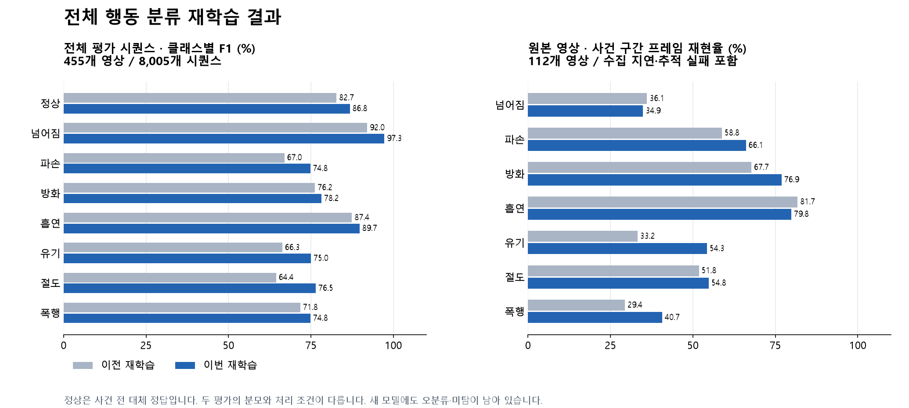

# 전체 행동 분류 오탐·미탐 점검 및 재학습 결과

평가일 2026-11-15 (한국시간)

목표는 특정 클래스의 표시 억제가 아니라 정상·넘어짐·파손·방화·흡연·유기·절도·폭행 전체의 오탐과 미탐을 줄이는 것이다. 모델은 8개 클래스를 동등하게 반영하는 검증 Macro-F1로 선택했다.

## 결과 판단

이전 재학습 모델 대비 평가 Macro-F1은 76.0% → 81.6%이며, 정확도는 78.2% → 83.0%다. 클래스별 개선 여부는 아래 표로 확인한다.

정상→이상 오탐은 21.3% → 13.1%다. 이상→정상 미탐은 7.4% → 8.5%다. 두 지표를 구분해야 한다.

미탐 수가 늘어난 이상행동도 있다. 흡연 +56개 시퀀스.

이번 재학습의 효과는 확인하되, 전체 오분류가 해결됐다는 뜻은 아니다. 다음 보강은 같은 자료를 그대로 반복 학습하기보다 실제 정상 구매·물건 확인·가방 정리와 클래스별 실패 영상을 추가하고, 추적/관절 수집 실패와 순수 분류 오류를 분리하는 방향이 필요하다.

## 확인된 문제

- 전달 문서의 주머니 동작을 재현했다. 이전 재학습 모델은 YOLO11n과 YOLO11s 관절 입력 모두에서 해당 10프레임 중 9프레임을 흡연으로 표시했다. 포즈 모델 차이만으로 설명되지 않는 분류 오류다.
- 기존 전체 재학습에는 관절 가림·좌우 반전·좌표 오차 증강이 없었다. 이번에는 같은 8개 클래스 구조를 유지하며 증강과 n/s 포즈 혼합 학습을 적용했다. 증강 부족이 단독 원인임을 입증한 실험은 아니다.
- 학습 입력은 3 FPS인데 기존 웹은 원본 FPS에 관계없이 30프레임을 수집했다. 고 FPS 영상에서는 시간 범위가 달라지는 코드 문제를 수정했다. 문서의 3 FPS 사례에는 이 문제가 원인이 아니었다.
- 클래스 번호는 정상 0, 넘어짐 1, 파손 2, 방화 3, 흡연 4, 유기 5, 절도 6, 폭행 7로 일치했다.

## 재학습

- RTX 3070에서 무작위 초기화로 학습했다. 검증 점수로 선택한 epoch는 53이다.
- 기존 전체 YOLO11n 학습 시퀀스에 YOLO11s 학습용 448개·검증용 112개 후보 영상에서 추출한 유효 시퀀스를 추가했다. 추가 영상은 촬영 그룹을 순회하며 결과를 보기 전에 결정했다.
- 학습 시퀀스 64,372개, 검증 시퀀스 11,821개를 사용했다. 추가 후보 중 실제 사건 시퀀스가 생성된 영상은 학습 397개, 검증 97개다.
- COCO 좌우 관절 교환, 상자 상대 좌표 이동·확대/축소, 관절 잡음, 관절/프레임 가림을 적용했다. 클래스 가중치는 역빈도의 제곱근이며 label smoothing은 0.03이다.
- 촬영 그룹별로 학습·검증·평가를 분리했다. 재현 영상의 촬영 그룹은 학습에 넣지 않았다. 모델 선택에는 검증 자료만 사용했다.

## 동일한 전체 평가 시퀀스

YOLO11n 기반 455개 영상, 8,005개 시퀀스. 수치는 30프레임 단위 argmax 분류이며 웹 사건 검출률과 다르다.

| 클래스 | 구형 v1 F1 | 구형 v2 F1 | 이전 재학습 F1 | 이번 재학습 F1 | 이번 정밀도 | 이번 재현율 |
|---|---:|---:|---:|---:|---:|---:|
| 정상 | 2.6% | 4.5% | 82.7% | 86.8% | 86.6% | 86.9% |
| 넘어짐 | 34.6% | 28.1% | 92.0% | 97.3% | 95.3% | 99.3% |
| 파손 | 69.3% | 57.6% | 67.0% | 74.8% | 69.6% | 80.8% |
| 방화 | 46.5% | 47.0% | 76.2% | 78.2% | 74.7% | 81.9% |
| 흡연 | 77.3% | 61.8% | 87.4% | 89.7% | 91.3% | 88.2% |
| 유기 | 45.4% | 52.3% | 66.3% | 75.0% | 75.8% | 74.1% |
| 절도 | 57.5% | 43.0% | 64.4% | 76.5% | 80.3% | 73.0% |
| 폭행 | 47.9% | 42.0% | 71.8% | 74.8% | 79.1% | 71.0% |

- 전체 정확도 78.2% → 83.0%
- Macro-F1 76.0% → 81.6%
- 정상을 이상행동으로 분류한 비율 21.3% → 13.1%
- 이상행동을 정상으로 분류한 비율 7.4% → 8.5%

### 클래스별 오탐·미탐

FP는 다른 정답을 해당 클래스로 예측한 수, FN은 해당 정답을 다른 클래스로 예측한 수다. 정상 클래스의 FP는 이상행동을 정상으로 놓친 경우를 뜻한다.

| 클래스 | 이전 FP | 이번 FP | 이전 FN | 이번 FN | 이번에 가장 많이 혼동한 행동 |
|---|---:|---:|---:|---:|---|
| 정상 | 361 | 417 | 661 | 407 | 방화 132건 |
| 넘어짐 | 44 | 13 | 2 | 2 | 정상 1건 |
| 파손 | 419 | 294 | 203 | 160 | 폭행 110건 |
| 방화 | 167 | 144 | 97 | 94 | 정상 86건 |
| 흡연 | 252 | 111 | 99 | 155 | 정상 124건 |
| 유기 | 110 | 93 | 144 | 102 | 정상 66건 |
| 절도 | 185 | 119 | 260 | 179 | 정상 84건 |
| 폭행 | 208 | 169 | 280 | 261 | 파손 198건 |

## 원본 영상 별도 평가

학습과 분리된 YOLO11s 원본 112개를 시도했고, 94개에서 정답 연결된 시퀀스를 얻었다. 동일 촬영의 카메라가 포함되므로 영상 수는 독립 촬영 수와 다르다. 촬영 그룹 수는 111개다.

| 행동 | 이전 웹 재현율 | 이번 웹 재현율 | 이번 감지 영상 / 시도 영상 |
|---|---:|---:|---:|
| 넘어짐 | 36.1% | 34.9% | 11 / 16 |
| 파손 | 58.8% | 66.1% | 15 / 16 |
| 방화 | 67.7% | 76.9% | 15 / 16 |
| 흡연 | 81.7% | 79.8% | 15 / 16 |
| 유기 | 33.2% | 54.3% | 15 / 16 |
| 절도 | 51.8% | 54.8% | 12 / 16 |
| 폭행 | 29.4% | 40.7% | 14 / 16 |

위 웹 재현율은 XML 사건 구간의 전체 프레임을 분모로 사용한다. 관절 수집 지연과 대상 인물 연결 실패도 미감지에 포함한다. 웹과 같은 EMA 0.6·표시 기준 50%를 적용한 행동 분류 경로를 재현했으며, DB 사건 저장·가판대/결제 규칙은 포함하지 않는다.

원본 영상의 정상 대체 구간에서 관측·분류된 프레임 중 이상행동으로 표시한 비율은 8.7% → 4.3%다.

## 주머니 동작 회귀 검사

사용자가 이번에 본 다른 영상의 경로와 시간대는 전달되지 않았다. 아래는 인수인계 문서에 기록된 CE 영상 44.67–47.67초의 결과다.

| 관절 입력 | 이전 표시 | 이번 표시 |
|---|---|---|
| yolo11n-pose.pt | {'normal': 1, 'smoking': 9} | {'normal': 6, 'smoking': 4} |
| yolo11s-pose.pt | {'normal': 1, 'smoking': 9} | {'normal': 1, 'smoking': 9} |

## 적용 파일과 한계

- 새 모델 `C:\Users\조기강\OneDrive\Desktop\coding\Deu_Capstone26-personal\train\1_behavior\retrained-20261115\kpt_behavior_repaired_3fps.pth`
- 배포용 SHA-256 `bc6fa7fb18fbeccc5dbea39ae559dc1c0697336d3842eac76071f4f16ff56c56`
- 모델에 학습 FPS와 클래스 순서를 포함했고, 웹 워커가 영상 시간에 맞춰 3 FPS로 행동 관절을 수집하도록 수정했다. 기존 plain state_dict 모델은 기존 동작을 유지한다.
- 새 모델을 다른 PC에서 사용할 때에는 변경된 `core/kpt_behavior_classifier.py`와 `backend/worker.py`도 함께 적용해야 FPS 보정이 동작한다.
- 기존 기본 가중치와 DB 등록은 자동 교체하지 않았다. 실제 서비스 적용 상태로 오해하지 않도록 새 모델을 별도 파일로 보관했다.
- 정상 정답은 사건 전 구간을 정상으로 간주한 대체 정답이다. 실제 매장의 정상 구매·주머니 정리·얼굴 만지기 전체를 대표하지 않는다.
- 촬영 그룹은 행동 종류·시나리오·장소·날짜로 구분했다. 배우와 장소 자체가 완전히 분리된 평가는 아니므로 새로운 매장에 대한 일반화는 추가 확인이 필요하다.
- 관절 모델은 담배·상품·주머니 내부를 직접 보지 않는다. 이 자료에서의 개선이 모든 현장 CCTV에 대한 해결을 보장하지 않는다.
- 세부 수치와 혼동행렬은 `evaluation.json`, 원본 영상별 결과는 `raw-test-streams.json`, 학습 이력은 `trained/training.json`에 있다.

## 코드 검증

- 영상 FPS 샘플링, 기존 가중치 호환성, 관절 추적 연속성, 웹 사건 기록 회귀 검사 15개를 통과했다.
- 별도의 소량 실행에서 모델·optimizer·scheduler·난수 상태가 저장 시점과 일치하게 복원되고 학습 단계가 이어지는 것을 확인했다. 연속 실행과 분리 실행의 최종 가중치가 비트 단위로 같다는 보장은 하지 않는다.
- 새 배포용 체크포인트는 웹 업로드 검사, 원본 학습 가중치와의 출력 일치 검사, 3 FPS 입력 규격 로드 검사를 통과했다.
