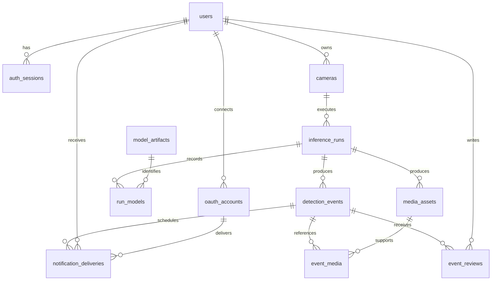

# 서버 배포용 데이터베이스 설계

기준: 2026-11-13 / 개인 저장소 `c7a7341`  
목표 DB: **PostgreSQL**  
상태: 논리·물리 설계 초안. [portfolio-schema.sql](portfolio-schema.sql)은 아직 실행하거나 앱에 적용하지 않았다.

## 1. 현재 저장 방식과 도입 이유

현재 SQLite/ORM은 없다. 알림은 메모리, 녹화 목록은 `recordings/recordings.json`, 토큰은 로컬 JSON, 영상은 로컬 파일로 관리한다. JSON 접근의 `threading.Lock`은 여러 프로세스가 공유하는 DB 락이 아니다.

웹 API, 추론 worker, 알림 worker가 함께 사건과 작업 상태를 관리하므로 PostgreSQL을 도입한다. SQLite도 소규모 웹 서버에서 사용할 수 있지만, 파일당 동시 writer가 하나이고 외부 프로세스·확장·운영 복구까지 고려하면 이번 목표에는 서버형 DB가 적합하다. [SQLite 공식 안내](https://www.sqlite.org/whentouse.html)

처음에는 개인 소유 모델을 사용한다. 사용자 한 명이 여러 영상 소스를 소유한다. 조직·매장·복잡한 멤버십 테이블은 실제 협업 요구가 생길 때 추가한다. UUID를 아는 것과 접근 권한을 가진 것은 다르므로, API는 항상 `camera.owner_id`까지 확인한다.

## 2. 엔티티 관계



## 3. 테이블 정의

모든 기본 식별자는 UUID, 절대 시각은 `TIMESTAMPTZ`다. DB에는 영상 BLOB, 카카오 토큰 원문, RTSP 비밀번호를 저장하지 않는다. 정확한 타입·CHECK·FK·인덱스는 동봉한 SQL을 기준으로 한다.

| 테이블 | 주요 필드 | 설계 의도 |
|---|---|---|
| `users` | `id`, `display_name`, `role`, `is_active`, `created_at` | 소유자와 읽기 전용 데모 사용자. 초기 로그인은 연결된 OAuth 계정 기반으로 설계 |
| `auth_sessions` | `user_id`, `token_hash`, `expires_at`, `revoked_at` | 무작위 고엔트로피 세션 토큰의 해시만 보관. 비밀번호 해시와 다른 개념 |
| `oauth_accounts` | `user_id`, `provider`, `provider_subject`, `token_secret_ref`, 만료 시각 | `(provider, provider_subject)` 유일. 카카오 계정 연결과 앱 세션을 구분 |
| `cameras` | `owner_id`, `name`, `source_type`, `source_uri` / `source_storage_key`, `credentials_ref`, `config` | RTSP뿐 아니라 샘플·업로드 파일도 논리적 영상 소스로 관리 |
| `model_artifacts` | `role`, `name`, `version`, `sha256`, `storage_key`, `labels`, `preprocessing` | 모델 파일·입력 의미를 고정. Pose/Object/Behavior 및 ReID 출처 기록 |
| `inference_runs` | `camera_id`, `worker_id`, `status`, `lease_token`, `heartbeat_at`, `lease_expires_at`, `config_snapshot` | 같은 카메라도 실행할 때마다 새 run. track_id는 run 안에서만 유효 |
| `run_models` | `run_id`, `role`, `model_artifact_id` | 한 실행에서 실제 사용한 모델 조합. 역할과 모델 역할을 복합 FK로 일치 |
| `detection_events` | `run_id`, `producer_event_key`, `event_type`, `track_id`, `detection_method`, `model_score`, `rule_code/version`, `evidence`, 각종 시각 | 사건 근거와 출처. 같은 worker 이벤트 재전송은 중복 사건을 만들지 않음 |
| `media_assets` | `run_id`, `kind`, `storage_key`, `status`, MIME/크기/길이/해시, 보존기한 | 녹화·스냅샷·썸네일 결과. 준비되지 않은 파일을 ready로 노출하지 않음 |
| `event_media` | `event_id`, `media_asset_id`, `run_id` | 한 녹화가 여러 사건을 담을 수 있음. 다른 run의 사건/영상을 잘못 연결할 수 없게 복합 FK 적용 |
| `event_reviews` | `event_id`, `reviewer_id`, `decision`, `note`, `created_at` | 사람이 검토한 판단 이력. 수정은 기존 행 변경 대신 새 검토 추가 |
| `notification_deliveries` | `event_id`, `recipient_user_id`, `oauth_account_id`, `status`, `attempt_count`, 재시도/lease 시각 | 알림 발송 이력이며 durable outbox 역할을 함께 수행 |

소스 업로드는 검증된 파일을 저장한 뒤 `cameras.source_storage_key`로 등록한다. 이 초안의 `media_assets`는 분석 결과용이다. 업로드 재개·중간 상태·복잡한 원본 파일 공유가 필요해지면 별도 `source_assets`를 추가한다.

## 4. 데이터의 의미와 무결성

### 사건과 시간

- `detected_at`: worker가 판단한 절대 시각.
- `received_at`: API/DB가 수신한 시각. 서로 다른 서버의 시계 차이 때문에 단순 대소 CHECK를 두지 않는다.
- `occurred_at`: 실제 촬영 절대 시각을 알 때만 기록. 촬영일을 모르는 업로드 영상은 NULL.
- `source_time_ms`, `source_frame_index`: 원본 영상 내 위치. 웹 타임라인·재분석에 사용한다.
- `source_end_time_ms`: 사건 구간 끝. 시작보다 앞설 수 없다.

전송하는 모든 절대 시각에는 UTC offset을 포함하고 화면에서 사용자 시간대로 변환한다. 예전 JSON의 시간은 timezone이 없으므로 이전 시 임의로 UTC라고 가정하지 않는다.

### 모델과 규칙

`model_score`에는 해당 모델이 실제 산출한 값만 기록한다. `detection_method='rule'`이면 모델 점수는 NULL이다. 손목/POS 규칙의 고정값 0.9를 90% 정확도로 저장하지 않는다.

모델을 사용한 점수는 `score_model_role`로 run의 모델에 연결한다. hybrid 결과도 모델 점수와 규칙 근거를 별도로 둔다. `preprocessing`에는 관절 순서, 결측값 의미, 좌표 정규화, 시퀀스 길이, 목표 샘플링 FPS, 버전을 기록한다. `config_snapshot`에는 임계값, 룰 버전, ROI, 이미지 해상도, 추적기/패키지 버전, 입력 파일 해시를 기록한다.

run 시작 이후 모델과 설정 snapshot은 변경하지 않는다. 설정이 달라지면 새 run을 만든다. 같은 가중치 파일을 썼어도 전처리나 정책이 다르면 동일 실험으로 취급하지 않는다.

### DB가 보장할 것과 서비스가 보장할 것

| DB 제약 | 별도 서비스 검사 |
|---|---|
| PK/FK, score 범위, 상태 enum, 필수 데이터 | 로그인·소유권·읽기 전용 데모 권한 |
| 카메라당 활성 run 한 개의 부분 UNIQUE | worker heartbeat 만료 판정, 실제 프로세스 중지, lease fencing |
| `(run_id, producer_event_key)` UNIQUE | 같은 키에 다른 내용이 들어오면 충돌 처리. 무조건 성공 응답하지 않음 |
| run 모델 역할 일치, event/media run 일치 | 필수 모델 조합·파일 해시·전처리 호환성 확인 |
| OAuth 계정/수신자/채널 일치 | 수신자가 해당 카메라 소유자이며 계정이 활성인지 확인 |
| 이벤트 검토 append-only trigger | 서버가 검토 시각을 지정하고 최신 판정 기준을 유지 |

PostgreSQL FK는 행 관계를 보장하지만 사용자 권한을 대신하지 않는다. FK의 참조 대상에는 PK/UNIQUE가 필요하며 참조하는 쪽의 조회 인덱스도 별도로 검토해야 한다. [PostgreSQL 제약조건 문서](https://www.postgresql.org/docs/18/ddl-constraints.html)

## 5. 사건 생성과 알림 트랜잭션

1. 내부 API에서 worker 자격·run의 현재 lease를 검증한다.
2. 한 DB 트랜잭션에서 사건을 기록하고 `notification_deliveries(status='queued')`를 생성한다.
3. 재전송이면 `(run_id, producer_event_key)`로 기존 사건을 확인하고, 내용이 동일한 요청에만 동일 ID를 반환한다.
4. commit 뒤 웹 구독자에게 알려 준다. 알림이 유실돼도 사건은 REST 조회로 복구된다.
5. 알림 worker가 `FOR UPDATE SKIP LOCKED`로 due 행을 획득하고 lease·시도 횟수를 저장한 다음 트랜잭션을 끝낸다.
6. DB 락을 붙잡지 않은 상태로 카카오를 호출하고 성공/재시도/실패를 기록한다. 응답 상태·timeout·백오프·최대 횟수를 적용한다.

외부 서버가 전송을 완료했지만 응답을 받지 못한 경우 중복 알림이 생길 수 있다. 공급자의 멱등성 보장 없이 “정확히 한 번 전달”을 약속하지 않는다. 발송 행 중복 방지와 외부 전송 보장은 구분한다.

## 6. 영상과 녹화의 생명주기

영상은 개발/첫 배포에서는 private persistent volume, 이후에는 private object storage에 둔다. DB에는 storage key만 보관하고 클라이언트가 절대 경로나 임의 저장 키를 선택하게 하지 않는다.

`pending → ready / failed` 상태에서 실제 파일 열기·크기·해시·브라우저 코덱을 검증한 후 ready로 변경한다. 파일 쓰기와 DB commit은 하나의 원자적 트랜잭션이 아니므로 미완료 업로드·고아 파일·missing 파일을 정리하는 정합성 작업이 필요하다.

삭제는 `deleting` 표시 → 파일 삭제 → `deleted`로 마무리한다. 파일 삭제가 실패하면 재시도한다. 보존기한 정책은 원본 업로드·사건 영상·썸네일·검토 이력별로 정하고, 공개 데모용 합성/동의된 영상과 실제 매장 영상을 분리한다.

카카오 서버가 썸네일을 읽어야 하는 경우에만 제한된 수명의 이미지 URL을 발급한다. 전체 캡처 디렉터리를 공개하거나 비공개 영상을 서비스 인증 없이 열어서는 안 된다.

## 7. 조회와 인덱스

- 카메라별 실행: `inference_runs(camera_id, started_at DESC)`.
- 실행별 사건: `detection_events(run_id, detected_at DESC)`; 안정적인 페이지 순서는 ID까지 포함한다.
- 유형별 사건: `detection_events(event_type, detected_at DESC)`.
- 사건의 최신 검토: `event_reviews(event_id, created_at DESC, id DESC)`.
- due 알림, 만료 lease, 미디어 보존기한에는 상태별 부분 인덱스.
- 카메라별 장기 검색은 run을 join한다. 규모가 커져 camera_id를 사건에 중복 저장하면 run/camera 복합 FK를 함께 추가한다.

예를 들어 사건 조회는 다음 관계를 따라 소유권을 확인한다. 바인딩된 매개변수를 사용하고 임의 정렬 SQL을 클라이언트에서 받지 않는다.

```sql
SELECT e.*
FROM detection_events e
JOIN inference_runs r ON r.id = e.run_id
JOIN cameras c ON c.id = r.camera_id
WHERE c.owner_id = :current_user_id
  AND c.id = :camera_id
ORDER BY e.detected_at DESC, e.id DESC
LIMIT :page_size;
```

기본 사건 상태는 최신 review에서 계산한다. 검토 상태별 대량 검색이 실제 병목이면 별도 projection을 추가하되, 원본 검토 이력과 한 트랜잭션에서 갱신한다.

## 8. 기존 데이터 이전 계획

1. JSON과 영상 파일을 원본 그대로 백업하고 읽기 전용으로 검사한다.
2. `recordings.json.source` 표시명을 새 camera UUID에 명시적으로 매핑한다. 이름만으로 자동 병합하지 않는다.
3. 파일 존재·크기·해시·경로 범위를 검사하여 새 storage key로 복사한다.
4. 새 사건/미디어 UUID를 생성하고 원본 JSON의 ID·import batch를 `evidence`의 legacy metadata로 남겨 재실행 중복을 막는다.
5. 기존 confidence의 출처가 불명확하면 새 모델 점수로 확정하지 말고 legacy 값으로 보존한다. 임의 모델/run 버전도 만들어 사실처럼 기록하지 않는다.
6. 기존 메모리 알림 목록의 사라진 기록은 복구할 수 없다. 녹화가 있다고 모든 과거 알림이 복원되는 것은 아니다.
7. 노출된 인증정보는 그대로 복사하지 않고 폐기·재인증한다. OAuth/RTSP 비밀값은 DB와 분리된 secret 저장 방식으로 이전한다.

## 9. 구현 전 검증 항목

현재 환경에 PostgreSQL 서버/클라이언트·Docker·PostgreSQL SQL parser가 없어 **DDL 실행 검증은 하지 않았다**. SQL은 정적 검토용이며 실제 migration으로 쓰기 전 다음을 검사해야 한다.

- 빈 PostgreSQL 개발 DB에서 DDL 및 Alembic upgrade/downgrade 실행.
- 잘못된 score, 다른 run의 media 연결, 다른 역할의 모델 연결, 다른 사용자의 OAuth 계정 연결이 DB 제약에 거절됨.
- 같은 카메라에서 동시 시작 요청이 와도 활성 run이 하나만 생김.
- 동일 이벤트 재전송·프로세스 재시작·알림 timeout 후에도 사건이 사라지지 않음.
- 오래된 lease를 가진 worker 결과는 새 run 상태를 덮어쓰지 못함.
- 원본 영상의 실제 촬영 시각을 모르는 경우 NULL과 source_time_ms로 정상 저장됨.
- 권한 검사는 DB 제약과 별도로 API 통합 시험에서 검증.
- token·RTSP 인증값·개인 영상 경로가 API 응답 및 로그에 남지 않음.

운영 DB를 이 SQL로 바로 생성하는 대신, 구현 단계에서 migration과 테스트를 같이 도입한다.
