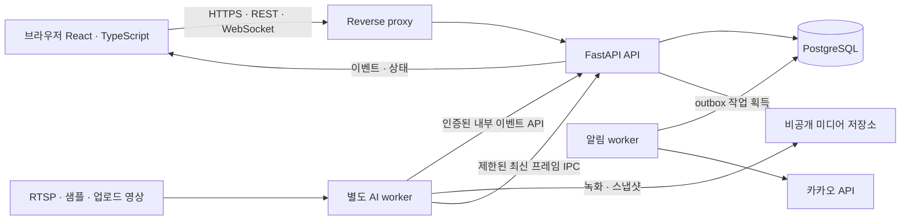

# 포트폴리오용 CCTV 웹 서비스 전환 검토

검토일: 2026-11-13 (Asia/Seoul)  
기준: 개인 저장소 `main`의 `c7a7341`, 원본 저장소 `master`의 `9dfce34`  
목표: **서버에 배포하고 외부 브라우저에서 접속할 수 있는 서비스**  
범위: 현재 코드 검토와 설계. 이 문서는 웹 전환·DB 구축·배포가 완료되었다는 의미가 아니다.

## 1. 현재 상태와 결론

| 영역 | 확인한 현재 상태 | 전환 방향 |
|---|---|---|
| 화면 | PyQt5 MDI, 로컬 파일 선택·OS 플레이어 | React + TypeScript 대시보드, 업로드·웹 재생 |
| API | FastAPI 알림 수신과 간단한 HTML 페이지 | 인증·권한·카메라/작업/이벤트 API로 확장 |
| 저장 | 메모리 알림 목록, 녹화 JSON, 토큰 JSON | PostgreSQL + 비공개 미디어 저장소 |
| AI | Pose + DeepSORT + 행동 분류 + 객체 감지 + 도난 규칙 | Qt와 분리된 추론 worker, 모델/규칙 버전 관리 |
| 배포 | 데스크톱 실행과 Windows/CUDA 중심 의존성 | Linux 컨테이너, CPU/GPU 의존성 분리, HTTPS |

SQLite를 사용 중이라는 추측은 코드와 다르다. `core/recorder.py:4`는 DB 대신 단일 JSON을 사용한다고 명시한다. `core/api_server.py:110`의 알림 목록은 프로세스 메모리이며 재시작 시 사라진다. `train/2_keypoint/dataset.py`의 `self.db`는 학습 JSON 변수다.

요구사항 1과 3은 하나의 웹 전환 작업이다. 화면을 HTML로 옮기기 전에 **서버가 영상 처리의 생명주기를 소유하도록 구조를 바꾸는 것**이 핵심이다.

## 2. 먼저 해결해야 할 문제

P0는 외부 공개 또는 신뢰할 수 있는 AI 결과 제시 전에 필요한 항목이다. 아래 내용은 발견 사항이며 아직 수정 완료된 항목이 아니다.

| 우선순위 | 발견 사항 / 코드 근거 | 필요한 변경 |
|---|---|---|
| P0 | README 말미에 RTSP 계정이 들어 있음 | 공개본에서 제거하고 카메라 비밀번호 교체. 커밋에서 지워도 과거 공개 이력은 별도 처리 필요. 실제 값은 이 문서에 복사하지 않음 |
| P0 | `POST /api/alert` 무인증, 이벤트 HTML 문자열 삽입, 캡처 디렉터리 공개 (`core/api_server.py:115,156,283`) | 브라우저 로그인·소유권 검사, worker 전용 인증, JSON 응답/안전한 렌더링, 미디어 접근 제어 |
| P0 | 전역 `current_user_id`와 OAuth state 미검증 (`core/api_server.py:71,236`) | 사용자별 계정 연결, 세션에 결합한 일회용 state, 알림 수신자 명시 |
| P0 | 학습/실행 저신뢰 관절 인코딩 불일치 (`train/1_behavior/kpt_common.py:29,53`, `core/kpt_behavior_classifier.py:95`) | 전처리 공유 및 버전 고정. 기존 모델을 보존하고 수정 전후 독립 재평가·필요시 재학습 |
| P0 | 사라진 트랙의 도난 상태는 설정되지만 반환에서 제외 (`core/theft_monitor.py:100,110`) | 트랙 표시 목록과 이벤트 발행 분리, 유실/재등장 테스트 |
| P0 | 규칙 판정에 고정 `0.9`를 모델 확률처럼 주입 (`core/video_thread.py:324`) | `model_score`와 `rule_code/evidence` 분리, 사용자에게 “도난 의심”으로 표현 |
| P0 | 표시 체크박스가 행동 추론 자체를 끔 (`core/video_thread.py:309`, `gui/main_window.py:452`) | 사용자별 표시 상태와 서버 감시 정책 분리 |
| P0 | 초 단위 이벤트/녹화 이름에 카메라 식별자가 없음 (`core/video_thread.py:350`, `core/recorder.py:159`) | UUID, run/track 범위, 고유 storage key로 교체 |
| P1 | JSON 전체 덮어쓰기와 프로세스 내부 Lock (`core/recorder.py:29,50`) | DB 트랜잭션, 파일 상태 관리, 이벤트와 녹화 연결 |
| P1 | 알림 HTTP 상태 미검사·실패 3회 후 중단 (`core/video_thread.py:499`) | durable outbox, timeout/백오프/재시도/실패 관측 |
| P1 | 파일 탐색 시 시계열 상태 미초기화, 규칙은 벽시계 사용 (`core/video_thread.py:263`, `core/theft_monitor.py:53`) | 소스 시간 전달, seek 시 새 run 또는 상태 초기화, 실시간 간격은 monotonic clock |
| P1 | 카메라마다 모델 로드, 모델 누락 시 기능이 조용히 축소 (`core/video_thread.py:201`) | 제한된 작업 수, 모델 준비 상태 노출, 필수 모델 부재 시 감시 시작 차단 |
| P1 | 녹화 `mp4v`, 파일 생성 성공 검증 부족 (`core/recorder.py:165`) | H.264 MP4 등 웹 호환 인코딩, ready/failed 상태, 실제 브라우저 재생 시험 |
| P1 | FastAPI/Uvicorn 의존성 누락, CUDA 전용 torch 명세 (`requirements.txt`) | API/worker/학습 의존성 분리, 재현 가능한 lock 및 컨테이너 빌드 |

현재 RTSP 입력을 공개 API로 그대로 옮겨서는 안 된다. 서버가 임의 주소에 접속하는 기능이 되므로 등록 권한, 허용 장치/망/프로토콜, DNS 재해석·redirect 정책, 자원 제한을 정해야 한다. 카메라 접속 비밀값은 응답·로그·브라우저로 전달하지 않는다.

## 3. 서버 배포 구조

첫 배포는 하나의 서버와 Docker Compose로 구성한다. `frontend/proxy`, `api`, `inference-worker`, `notification-worker`, `postgres`를 분리하고 DB·미디어에는 영구 볼륨과 백업을 둔다. GPU 서버 사양과 동시 카메라 수는 벤치마크 후 결정한다. 지금 4개/9개를 보장할 근거는 없다.

FastAPI worker 수를 늘리면 각 프로세스의 모델 메모리가 복제될 수 있다. 추론을 HTTP 요청 처리나 단순 BackgroundTasks 안에서 장기 실행시키지 않는다. 먼저 API 1개 프로세스와 별도 추론 worker로 시작한다. [FastAPI 배포 문서](https://fastapi.tiangolo.com/deployment/concepts/)

브라우저 새로고침·탭 종료는 감시 종료와 별개다. 시작/정지는 서버의 run 상태를 변경하는 명시적 명령이다. 여러 시청자는 한 run을 구독하며, 접속할 때마다 모델을 새로 띄우지 않는다.

### 데이터 전달과 영상 전달

- **REST:** 카메라 등록, 분석 시작·정지, 업로드, 이벤트 조회·검토, 녹화 조회·삭제.
- **WebSocket:** 이벤트 UUID, 카메라 상태, 진행률, FPS, 지연, frame sequence 같은 작은 JSON. 프레임 전체를 DB에 저장하지 않는다.
- **MVP 영상:** 1~2개 샘플/분석 작업에 대해 낮은 해상도·FPS의 인증된 MJPEG 미리보기. worker→API는 길이가 제한된 IPC/내부 채널을 두고 카메라별 최신 프레임만 유지한다. 서로 다른 프로세스의 Python 전역변수는 공유되지 않는다.
- **확장 영상:** 처리된 스트림을 FFmpeg→MediaMTX→WebRTC/HLS로 제공. 서버만 RTSP 주소를 알고 브라우저에는 제한된 스트림 접근 권한만 발급한다. HLS는 WebRTC보다 지연이 커질 수 있으므로 실제 네트워크에서 선택한다. [MediaMTX 브라우저 안내](https://github.com/bluenviron/mediamtx/blob/main/docs/5-read/07-web-browsers.md)
- **녹화 재생:** 인증 후 HTTP Range가 되는 영상 응답 또는 짧은 수명의 서명 URL. MP4 확장자만으로 브라우저 호환성을 보장할 수 없다. 현재 MP4V-ES를 그대로 배포하지 않고 Chrome/Safari에서 검증한다. [MDN 코덱 안내](https://developer.mozilla.org/en-US/docs/Web/Media/Guides/Formats/Video_codecs#mp4v-es)

느린 클라이언트 때문에 추론이 멈추지 않도록 미리보기 프레임은 건너뛸 수 있게 한다. 사건 기록은 DB에 먼저 보존하고 클라이언트 재접속 시 REST로 다시 조회한다. 메모리 WebSocket 연결 목록은 한 프로세스에서만 유효하므로 다중 API 프로세스 전환 시 공유 pub/sub와 재구독 방식을 추가해야 한다. [FastAPI WebSockets](https://fastapi.tiangolo.com/advanced/websockets/)

### 카메라 위치의 차이

| 소스 | 서버 배포 후 의미 | 권장 순서 |
|---|---|---|
| 샘플·업로드 영상 | 서버가 접근 가능한 파일 | 첫 외부 공개 데모 |
| 서버 USB 웹캠 | `cv2.VideoCapture(0)`은 서버 장치 | 장비가 있는 환경에서만 |
| 매장 RTSP | 클라우드가 사설 LAN에 자동 접근할 수 없음 | VPN 또는 매장 edge worker 연결 후 |
| 접속자 노트북 웹캠 | 서버의 웹캠 번호로 열 수 없음 | 별도 브라우저 capture/ingest 기능 |

브라우저 웹캠은 `getUserMedia` 권한과 HTTPS/localhost 조건을 충족해야 한다. 초기 MVP에 이 입력 경로까지 동시에 넣지 않는다. [MDN getUserMedia](https://developer.mozilla.org/en-US/docs/Web/API/MediaDevices/getUserMedia)

## 4. GUI 기능의 웹 화면 재설계

| 화면 | 필요한 기능 | 기존 기능에서 달라질 점 |
|---|---|---|
| 모니터링 | 카메라 그리드, 감시/연결 상태, 이벤트 타임라인 | MDI 자유창 대신 반응형 그리드. 시청 중단과 감시 중단 구분 |
| 사건 목록·상세 | 시간/카메라/유형/검토 상태 필터, 영상·스냅샷, 판단 근거 | 원래 모델 결과와 사람의 정상/오탐/확인 필요 판정을 별도 보관 |
| 영상 분석 | 업로드·진행률·재시도·동일 영상 재분석 | 사용자의 로컬 경로 대신 서버 storage key, 파일 크기/길이 제한 |
| 소스·정책 설정 | 카메라 연결, 가판대/POS 영역, 감시 임계값 | 등록 권한 제한, 모델 threshold와 화면 표시 옵션 분리 |
| 모델·운영 | 모델 버전/해시, 준비 상태, FPS/지연/오류, 알림 실패 | 모델이 없어도 전체 기능이 정상인 것처럼 보이는 상태 방지 |

브라우저의 박스·키포인트·라벨 숨기기는 사용자 표시 설정이다. 사람별 오버레이 선택을 제공하려면 원본 영상과 frame sequence/PTS가 맞는 메타데이터를 별도로 렌더링한다. 서버에서 이미 박스를 그린 영상에는 클라이언트별 숨기기가 불가능하다는 점을 구현 범위에 반영한다.

카메라 인원 합계를 “고유 방문자 수”로 표현하지 않는다. 현재 추적 ID는 카메라/run 범위의 임시 ID이며 신원 식별 기능이 아니다.

### API 초안

| 경로 | 역할 |
|---|---|
| `/api/v1/auth/*` | 로그인·로그아웃·세션·계정 연결 |
| `/api/v1/cameras` | 소유한 영상 소스 CRUD, 비밀값 반환 금지 |
| `/api/v1/cameras/{id}/runs` | 분석 시작, 같은 명령의 재전송은 멱등 처리 |
| `/api/v1/runs/{id}` | 상태·진행률·종료 요청 |
| `/api/v1/uploads` | 크기·형식 제한과 소유권이 있는 업로드 |
| `/api/v1/events` | 필터 + `(detected_at,id)` 등 안정적인 cursor 페이지네이션 |
| `/api/v1/events/{id}/reviews` | 검토 이력 추가 |
| `/api/v1/media/{id}` | 권한 검사 후 조회·재생·삭제 |
| `/api/v1/models` | 등록된 모델·검증 상태, 임의 pickle 업로드 금지 |
| `/ws/v1/monitoring` | 인증된 상태/이벤트 구독 |
| `/internal/v1/events` | 허가된 worker만 이벤트 수신, 공개 브라우저 API와 분리 |

## 5. 데이터베이스와 AI 연결

PostgreSQL을 새로 도입한다. SQLite로 웹 서비스가 불가능한 것은 아니지만, 별도 추론/알림/API 프로세스에서 쓰기와 복구 상태를 관리할 목표에는 서버형 DB가 적합하다. SQLite는 DB 파일당 동시에 한 writer만 허용한다. [SQLite 공식 사용 지침](https://www.sqlite.org/whentouse.html)

테이블 관계·트랜잭션·기존 JSON 이전 계획은 [데이터베이스 설계](database-design.md), 실행 전 검토할 DDL은 [PostgreSQL 설계 초안](portfolio-schema.sql)에 둔다. 모델 파일 자체는 DB에 넣지 않고 해시·버전·입력 정의를 관리한다.

원본 GitHub 최종 가중치 3개가 현재 저장소에 포함되어 있으며 바이트 단위로 동일하다. `objects.pt`는 가판대/결제기, `kpt_behavior.pth`는 8개 행동, `yolo11n-pose.pt`는 사람 포즈를 담당한다. DeepSORT의 ReID 가중치는 설치 패키지에 별도로 포함된다. 자세한 검사와 한계는 [모델 검토](model-audit.md), 기계 판독용 목록은 [모델 manifest](model-manifest.json)에 기록한다.

## 6. 구현 순서와 완료 기준

| 단계 | 구현 범위 | 완료 기준 |
|---|---|---|
| 0. 공개 준비 | 노출 인증정보 교체·제거, 공개 데모 영상/권한 정의, 의존성 정리 | 새 환경 설치 재현, 로그/README/응답에 비밀값 없음 |
| 1. 추론 코어 | Qt 분리, 공통 전처리, 영상시간, 이벤트 UUID, 룰 결과 분리 | 헤드리스 샘플 분석, 저신뢰 관절·seek·트랙 소실 회귀 검사 |
| 2. DB/API | Alembic migration, 인증, 카메라/run/이벤트/미디어, outbox | 재시작 후 기록 유지, 재전송 중복 방지, 소유권 격리 |
| 3. 웹 MVP | 그리드, 샘플/업로드 분석, 사건 검색·검토·재생 | 외부 HTTPS 접속, 표시 옵션/탭 종료가 감시에 영향 없음 |
| 4. 운영 배포 | 컨테이너, 영구 볼륨, 복구·보존정책, 제한된 동시 분석 | 프로세스 장애 복구, DB 백업 복원, 알림 실패 재시도 |
| 5. AI 개선 | 독립 데이터 분할, 평가 기준선, 전처리 수정 모델 비교 | 클래스별 F1/AP, 이벤트 오탐/시간·미탐·탐지지연, 재현 가능한 보고서 |

처음부터 Kubernetes·다중 조직·대규모 메시지 브로커·모델 자동학습까지 만들 필요는 없다. 먼저 한 서버에서 작동하고 측정 가능한 웹 서비스를 만든다.

## 7. 포트폴리오에서 입증할 내용

- 화면 전환 전후의 구조도와 “Qt에서 추론 분리” 설계 결정.
- 두 소스의 동시 사건에도 UUID·영상 파일·DB 레코드가 충돌하지 않는 재현.
- 미승인 사용자/다른 소유자가 영상과 카메라를 보거나 제어할 수 없는 API 검사.
- 이벤트 저장 직후 API 또는 알림 worker를 재시작해도 사건이 남고 재시도되는 장애 시험.
- 모델 SHA-256, 전처리/규칙 버전, 데이터셋 분할과 환경을 함께 남긴 성능 비교.
- 추론 FPS뿐 아니라 카메라→화면 지연, 사건→알림 지연, P95 API 지연, 큐 깊이와 메모리.
- “도난 확정 AI” 대신 “포즈·객체·행동 분류와 규칙 기반 의심 이벤트를 사람이 검토하는 서비스”로 정확히 설명.

정확도·동시 카메라 수·지연 목표치는 아직 측정된 성과가 아니다. 기존 데모 영상의 성공 사례와 독립 테스트셋의 성능을 분리해서 제시한다.
